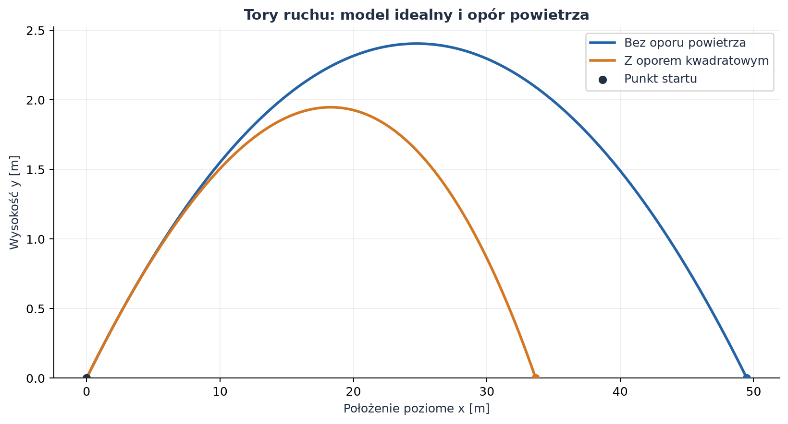
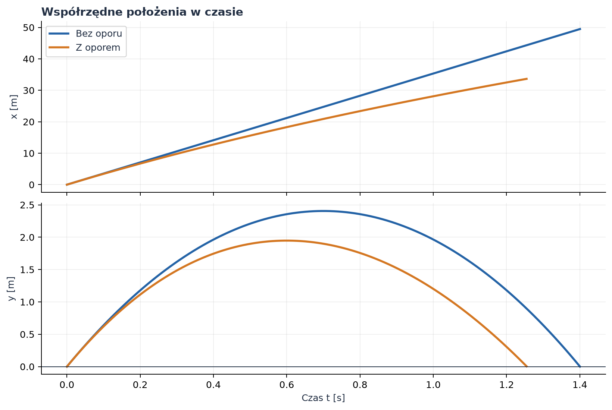
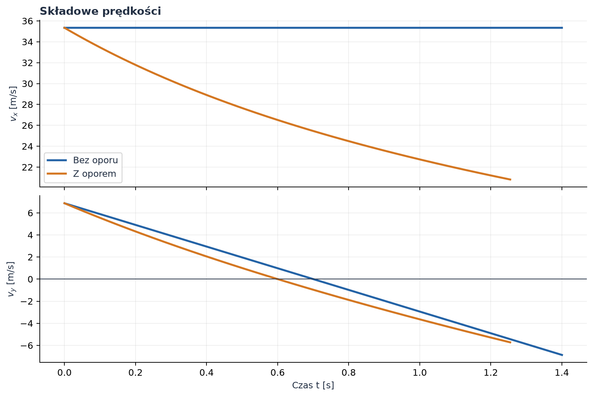
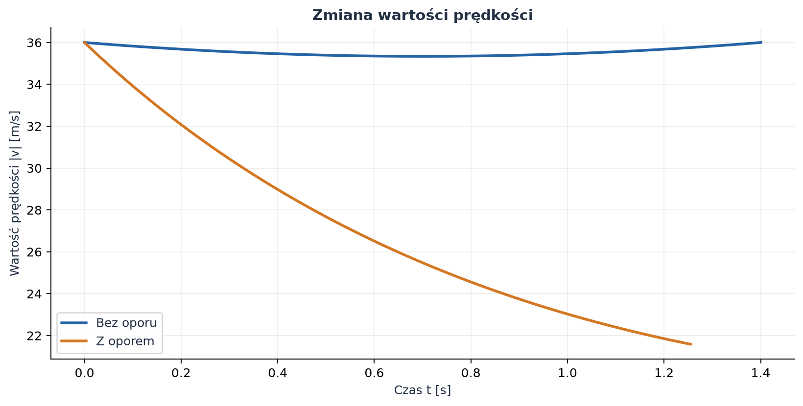
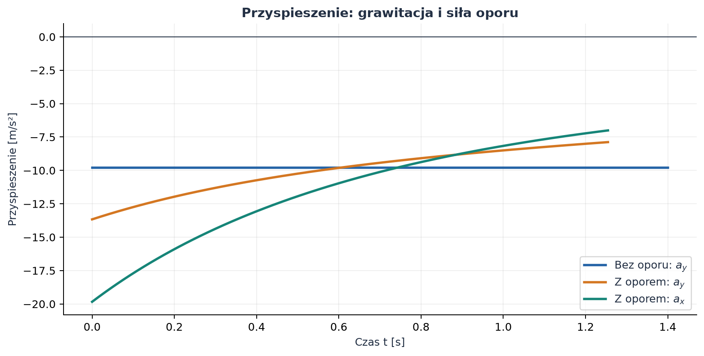
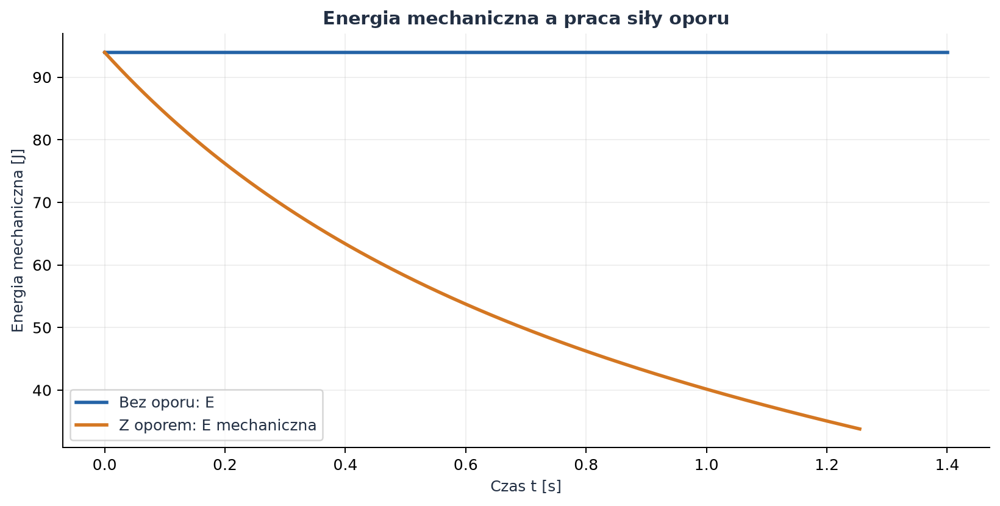

# Rzut ukośny bez oporu i z oporem powietrza

## Cel i założenia

Rzut ukośny jest ruchem ciała, któremu nadano prędkość początkową pod kątem do poziomu. W polu grawitacyjnym tor jest parabolą, jeśli pominiemy opór powietrza. Po uwzględnieniu oporu tor przestaje być parabolą, a prędkość i przyspieszenie trzeba wyznaczyć z równań ruchu.

W raporcie porównano oba modele dla tej samej prędkości początkowej i kąta:

$$
v_0=36\ \mathrm{m/s}, \qquad
\alpha=11^\circ=\frac{11\pi}{180}\ \mathrm{rad}
\approx 0{,}191986\ \mathrm{rad}.
$$

Przyjmujemy poziomą oś $x$ i pionową oś $y$ skierowaną w górę. Początek układu jest punktem wyrzutu, a lądowanie następuje na tej samej wysokości ($y=0$). Przyspieszenie grawitacyjne jest stałe i wynosi $g=9{,}81\ \mathrm{m/s^2}$. Pomijamy obrót Ziemi, wiatr i zmianę gęstości powietrza z wysokością.

Do modelu z oporem przyjęto parametry przykładowej piłki:

| Wielkość | Symbol | Wartość | Jednostka SI |
|---|---:|---:|---|
| masa ciała | $m$ | $0{,}145$ | $\mathrm{kg}$ |
| średnica | $d$ | $0{,}100$ | $\mathrm{m}$ |
| gęstość powietrza | $\rho$ | $1{,}225$ | $\mathrm{kg/m^3}$ |
| współczynnik oporu kuli | $C_D$ | $0{,}47$ | bezwymiarowy |
| pole przekroju | $A=\pi(d/2)^2$ | $0{,}007854$ | $\mathrm{m^2}$ |
| przyspieszenie grawitacyjne | $g$ | $9{,}81$ | $\mathrm{m/s^2}$ |

Parametry ciała i powietrza są założeniami modelowymi, a nie pomiarami. Dzięki temu wynik dla oporu jest jednoznaczny i odtwarzalny.

## 1. Rozkład prędkości początkowej

Wektor prędkości początkowej rozkładamy na składowe:

$$
v_{x0}=v_0\cos\alpha,\qquad v_{y0}=v_0\sin\alpha.
$$

Po podstawieniu danych:

$$
v_{x0}=36\cos(11^\circ)\approx35{,}339\ \mathrm{m/s},
\qquad
v_{y0}=36\sin(11^\circ)\approx6{,}869\ \mathrm{m/s}.
$$

Kontrola: $v_{x0}^2+v_{y0}^2=v_0^2$, zatem początkowa wartość prędkości wynosi $36\ \mathrm{m/s}$.

## 2. Rzut bez oporu powietrza

### 2.1. Równania ruchu

Na ciało działa tylko siła ciężkości. Z drugiej zasady Newtona, osobno dla obu osi:

$$
m\ddot{x}=0,\qquad m\ddot{y}=-mg.
$$

Po podzieleniu przez masę otrzymujemy przyspieszenia:

$$
\ddot{x}=0,\qquad \ddot{y}=-g.
$$

Całkujemy pierwsze równanie, korzystając z warunków początkowych $x(0)=0$ i $\dot{x}(0)=v_{x0}$:

$$
v_x(t)=v_{x0},\qquad x(t)=v_{x0}t.
$$

Analogicznie dla osi pionowej, z $y(0)=0$ i $\dot{y}(0)=v_{y0}$:

$$
v_y(t)=v_{y0}-gt,\qquad
y(t)=v_{y0}t-\frac{1}{2}gt^2.
$$

Są to równania parametryczne toru. Eliminując czas $t=x/v_{x0}$ z równania wysokości, dostajemy:

$$
y(x)=x\tan\alpha-\frac{g x^2}{2v_0^2\cos^2\alpha}.
$$

Równanie ma postać funkcji kwadratowej, więc tor w modelu idealnym jest parabolą.

### 2.2. Czas lotu, wysokość maksymalna i zasięg

Chwila osiągnięcia wierzchołka toru wynika z warunku $v_y=0$:

$$
0=v_{y0}-gt_{\mathrm{w}},\qquad
t_{\mathrm{w}}=\frac{v_{y0}}{g}.
$$

Wysokość maksymalną otrzymujemy, podstawiając ten czas do $y(t)$:

$$
H=y(t_{\mathrm{w}})
=v_{y0}\frac{v_{y0}}{g}
-\frac{g}{2}\left(\frac{v_{y0}}{g}\right)^2
=\frac{v_{y0}^2}{2g}
=\frac{v_0^2\sin^2\alpha}{2g}.
$$

Przy lądowaniu na wysokości startu $y(T)=0$. Nietrywialnym rozwiązaniem równania
$v_{y0}T-\frac12gT^2=0$ jest:

$$
T=\frac{2v_{y0}}{g}=\frac{2v_0\sin\alpha}{g}.
$$

Zasięg poziomy to $R=x(T)$:

$$
R=v_{x0}T
=\frac{v_0^2\sin(2\alpha)}{g}.
$$

Dla zadanych danych otrzymujemy:

| Wynik bez oporu | Wartość |
|---|---:|
| czas wznoszenia $t_{\mathrm{w}}$ | $0{,}7002\ \mathrm{s}$ |
| czas całego lotu $T$ | $1{,}4004\ \mathrm{s}$ |
| wysokość maksymalna $H$ | $2{,}4049\ \mathrm{m}$ |
| zasięg $R$ | $49{,}4893\ \mathrm{m}$ |

Przyspieszenie jest stałe: $a_x=0\ \mathrm{m/s^2}$ i $a_y=-9{,}81\ \mathrm{m/s^2}$.
W najwyższym punkcie $v_y=0$, ale prędkość całkowita nie jest zerowa, ponieważ
$v_x$ pozostaje równe $35{,}339\ \mathrm{m/s}$.

## 3. Rzut z oporem powietrza

### 3.1. Model siły oporu

Dla ciała poruszającego się w powietrzu przyjmujemy kwadratowy model oporu:

$$
\vec{F}_D=-\frac12\rho C_D A\,|\vec{v}|\,\vec{v}.
$$

Znak minus oznacza, że siła jest skierowana przeciwnie do wektora prędkości. Moduł
siły wynosi $F_D=\frac12\rho C_D A v^2$ i rośnie z kwadratem szybkości. Wprowadzamy
współczynnik

$$
k=\frac12\rho C_D A
=\frac12(1{,}225)(0{,}47)(0{,}00785398)
\approx0{,}00226096\ \mathrm{kg/m}.
$$

Wtedy $F_D=k v^2$. Jednostka $k$ wynika z $[\rho A]=\mathrm{kg/m}$, a iloczyn
$k v^2$ ma jednostkę $\mathrm{kg\,m/s^2}=\mathrm{N}$.

Ponieważ $|\vec v|=\sqrt{v_x^2+v_y^2}$, równania ruchu wynikające z drugiej zasady
Newtona są następujące:

$$
\begin{aligned}
\dot{x}&=v_x, & \dot{y}&=v_y,\\
\dot{v}_x&=-\frac{k}{m}\sqrt{v_x^2+v_y^2}\,v_x, &
\dot{v}_y&=-g-\frac{k}{m}\sqrt{v_x^2+v_y^2}\,v_y.
\end{aligned}
$$

Warunki początkowe są takie same jak w modelu idealnym:

$$
x(0)=y(0)=0,\qquad
v_x(0)=35{,}339\ \mathrm{m/s},\qquad
v_y(0)=6{,}869\ \mathrm{m/s}.
$$

### 3.2. Dlaczego rozwiązanie jest numeryczne?

W równaniach przyspieszenia składowe $v_x$ i $v_y$ są sprzężone przez
$\sqrt{v_x^2+v_y^2}$. Nie można więc osobno rozwiązać dwóch prostych równań
stałego przyspieszenia ani użyć parabolicznego wzoru na tor. Układ całkujemy
numerycznie metodą Rungego–Kutty (`solve_ivp` z adaptacyjnym krokiem). Obliczenie
kończy się przy pierwszym ponownym przejściu przez $y=0$ w kierunku w dół.

W modelu z oporem pozioma składowa prędkości maleje, a pionowa składowa
przyspieszenia zależy od kierunku ruchu. Podczas wznoszenia opór zmniejsza
przyspieszenie w dół, natomiast podczas opadania działa w górę i zwiększa
przyspieszenie skierowane ku górze względem samej grawitacji.

### 3.3. Wyniki obliczeń

| Wielkość | Bez oporu | Z oporem kwadratowym |
|---|---:|---:|
| czas lotu | $1{,}4004\ \mathrm{s}$ | $1{,}2555\ \mathrm{s}$ |
| wysokość maksymalna | $2{,}4049\ \mathrm{m}$ | $1{,}9474\ \mathrm{m}$ |
| zasięg | $49{,}4893\ \mathrm{m}$ | $33{,}6641\ \mathrm{m}$ |

W tych założeniach opór skraca zasięg o około $15{,}83\ \mathrm{m}$, czyli o
$32{,}0\%$ w stosunku do modelu bez oporu. Wartości te dotyczą wyłącznie
przyjętej masy, średnicy, gęstości powietrza i współczynnika $C_D$; nie są
uniwersalnymi wynikami dla dowolnego pocisku.

## 4. Wykresy

Poniższe rysunki zostały wygenerowane z kodu Pythona zamieszczonego w dalszej
części raportu. Osie i wielkości fizyczne są podane w jednostkach SI.



*Rysunek 1. Tor idealny jest parabolą. Przy oporze kwadratowym tor jest niższy i
ma krótszy zasięg.*



*Rysunek 2. Położenie poziome $x(t)$ przestaje rosnąć jednostajnie po
uwzględnieniu oporu. W obu modelach ruch pionowy kończy się na poziomie
$y=0$.*



*Rysunek 3. Bez oporu $v_x$ jest stałe, a $v_y$ zmienia się liniowo. Z oporem
maleją obie składowe prędkości.*



*Rysunek 4. W modelu idealnym wartość prędkości jest najmniejsza w wierzchołku
toru. Opór rozprasza energię i szybkość maleje w porównaniu z lotem idealnym.*



*Rysunek 5. Bez oporu działa wyłącznie stałe przyspieszenie grawitacyjne. Przy
oporze pojawia się także pozioma składowa przyspieszenia.*



*Rysunek 6. Bez oporu suma energii kinetycznej i potencjalnej jest stała. Przy
oporze energia mechaniczna maleje, ponieważ siła oporu wykonuje ujemną pracę.*

## 5. Energia i kontrola fizyczna

Energia mechaniczna względem poziomu wyrzutu wynosi:

$$
E_{\mathrm{mech}}=\frac12m(v_x^2+v_y^2)+mgy.
$$

W modelu bez oporu nie ma sił rozpraszających, więc $E_{\mathrm{mech}}$ jest
stała. Początkowa energia kinetyczna wynosi
$E_0=\frac12mv_0^2\approx94{,}0\ \mathrm{J}$.

Siła oporu zawsze działa przeciwnie do prędkości, zatem jej moc jest
nie dodatnia:

$$
P_D=\vec{F}_D\cdot\vec{v}
=-\frac12\rho C_D A|\vec{v}|^3\leq0.
$$

W konsekwencji energia mechaniczna maleje w czasie w modelu z oporem, co
potwierdza wykres energii. W punkcie najwyższym toru nadal zachodzi $v_y=0$,
ale z powodu oporu prędkość pozioma jest już mniejsza niż początkowa.

## 6. Kod i odtwarzanie wyników

Pełny, wykonywalny skrypt znajduje się w pliku
[generuj_wykresy.py](generuj_wykresy.py). Zapisuje sześć wykresów w katalogu
`files/rzut_ukosny/` i wypisuje wartości wykorzystane w tabelach. Do uruchomienia
potrzebne są pakiety `numpy`, `scipy` i `matplotlib`:

```bash
python -m pip install numpy scipy matplotlib
python pages/solutions/04_sol_vscode/generuj_wykresy.py
```

Najważniejszy fragment kodu modelu numerycznego pokazano poniżej:

```python
def rhs(t, stan):
    x, y, vx, vy = stan
    speed = np.hypot(vx, vy)
    ax = -(k / m) * speed * vx
    ay = -g - (k / m) * speed * vy
    return vx, vy, ax, ay


def ladowanie(t, stan):
    return stan[1]  # y = 0


ladowanie.terminal = True
ladowanie.direction = -1

stan_poczatkowy = (
    0.0,
    0.0,
    v0 * np.cos(alpha),
    v0 * np.sin(alpha),
)
rozwiazanie = solve_ivp(
    rhs,
    (0.0, 20.0),
    stan_poczatkowy,
    events=ladowanie,
    dense_output=True,
    rtol=1e-10,
    atol=1e-12,
)
if not rozwiazanie.success:
    raise RuntimeError(rozwiazanie.message)
```

W tym fragmencie `k = 0.5 * rho * C_D * A`, `m` jest masą, a `g` przyspieszeniem
grawitacyjnym. Pełny skrypt zawiera również obliczenia rozwiązania analitycznego,
generowanie wykresów i kontrolę poprawności obliczeń numerycznych.

## 7. Wnioski

1. Bez oporu ruch poziomy jest jednostajny, pionowy jednostajnie przyspieszony,
   a tor jest parabolą. Czas lotu, wysokość maksymalną i zasięg można wyprowadzić
   bezpośrednio z równań kinematycznych.
2. Opór kwadratowy zależy od całego wektora prędkości, dlatego sprzęga ruch w
   obu osiach. Dla przyjętego modelu trzeba rozwiązać układ równań numerycznie.
3. Dla $v_0=36\ \mathrm{m/s}$ i $\alpha=11^\circ$ model idealny daje zasięg
   $49{,}4893\ \mathrm{m}$, a model z oporem kuli o masie $0{,}145\ \mathrm{kg}$
   i średnicy $0{,}100\ \mathrm{m}$ daje $33{,}6641\ \mathrm{m}$.
4. W modelu idealnym energia mechaniczna jest zachowana. Opór powietrza wykonuje
   ujemną pracę i powoduje jej spadek.